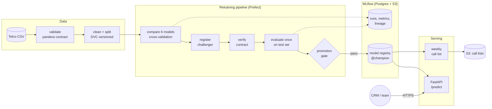

# Customer Retention ML Platform

[](https://github.com/rafiulhc/customer-retention-ml-platform/actions/workflows/ci.yml)


**An end-to-end machine learning system that predicts which customers will cancel, decides who a
retention team should call each week, and keeps itself up to date.** It covers data validation, model
selection, experiment tracking, a model registry, a gated retraining pipeline, an online API and batch scoring,
CI, and deployment to AWS with Terraform.

It is an MLOps project built on production practices: every decision is written down before the results are
seen, every model can be traced to its exact code and data, and nothing reaches production without passing a
pre-registered gate.

---

## Results

On a held-out test set of 1,409 customers, looked at once:

| | Model (logistic regression) | Rule baseline (contract + tenure) | Difference [95% CI] |
|---|---:|---:|---:|
| **PR-AUC** (primary) | **0.632** | 0.544 | **+0.088** [+0.034, +0.140] |
| ROC-AUC | 0.841 | 0.792 | |
| Precision of the call list (top 10%) | 0.745 | 0.645 | |
| Brier score (lower is better) | **0.139** | 0.279 | |
| Expected profit, top 10% | $19,678 | $15,927 | +$3,752 (+24%) [−$268, +$7,236] |

- **The model ranks churn risk clearly better than the rule** a manager could build in a spreadsheet, and it is
  **calibrated** (expected calibration error 0.023): "30% risk" means about 30% leave. That makes a cost-based
  call policy possible: **call when P(leaves) ≥ 0.28**, close to the break-even of 0.224.
- **Simple won.** Logistic regression tied XGBoost and LightGBM (PR-AUC 0.662 vs 0.661 and 0.653 in
  cross-validation, and still within noise after Optuna tuning), so the simpler, explainable model ships.
- **The bottleneck is capacity, not accuracy.** About 1,300 active customers are worth a call each week; the team
  can make 100. Calling everyone above the threshold would roughly double expected profit.
- **Honest about uncertainty.** The profit gain is consistent (5 out of 5 cross-validation folds) but not
  statistically conclusive on one test set. The ship decision and the criteria for future versions are recorded in
  [docs/evaluation.md](docs/evaluation.md), without moving the goalposts.

> Profit figures use **assumed** costs and save rates (`src/retention/config.py`): the dataset is IBM's public Telco
> sample, a fictional company. The ranking and calibration results are measured; the dollars are illustrative.

---

## Architecture



On AWS (`infra/terraform`): **CloudFront → ALB → ECS Fargate** (API and MLflow, on Graviton), **RDS Postgres**,
**S3**, **ECR**, pipeline tasks run by **EventBridge Scheduler**, CloudWatch alarms, and a **GitHub OIDC** role, so
no AWS keys are stored in GitHub. The same images and code run locally with `docker compose`.

---

## What makes it production-grade

| Practice | How |
|---|---|
| **Decisions before results** | Metrics, costs, baselines and success criteria fixed before modelling ([framing](docs/problem_framing.md)). Criteria changes are dated amendments that apply only to future versions |
| **The test set is used once** | Thresholds and calibration are chosen on out-of-fold training predictions. A guard refuses a second test evaluation of the same model version. CI never touches the test set |
| **Data contracts** | One pandera schema validates training data *and* generates the API's request model, so both accept exactly the same data |
| **Lineage** | Every run and model version is tagged with the git commit, a dirty flag and a **content fingerprint** of the data. DVC can restore the data of any commit |
| **Gated promotion** | A new version replaces `@champion` only if it beats the rule on PR-AUC, isn't clearly worse on profit, and isn't worse than the current champion (95% paired bootstrap intervals) |
| **No training/serving skew** | The API and the batch job share one scoring class. Explanations use the exact closed form of linear SHAP, tested equal to `shap.LinearExplainer` |
| **Safe deployments** | Rolling deploys with automatic rollback (circuit breaker + CloudWatch alarms). Tested: a broken release was rolled back with no human involved, while 40/40 health checks passed |
| **Supply chain** | Pinned dependencies with a 14-day cooldown, actions pinned to commit SHAs, base images pinned by digest, pip-audit and Trivy in CI, non-root containers |
| **Least privilege** | One IAM role per job (the API has no AWS permissions at all), secrets generated by AWS and never in code |

---

## Engineering notes: what broke when it ran for real

Running the system, not just testing it, found problems no unit test did. Each is fixed, regression-tested and
written up:

- **A library upgrade made identical data look new.** Retraining compared file checksums, and Parquet files record the
  writer's version. The pipeline retrained and promoted an identical model. Fix: decide "same data?" by a
  **content fingerprint** ([pipeline.md](docs/pipeline.md#incident-the-first-real-run-retrained-on-unchanged-data)).
- **A month without brand-new customers would have broken training.** With no blank values, pandas guessed a text
  column was numeric, and the data contract rejected the file. Fix: explicit column types ([serving.md](docs/serving.md)).
- **The threshold optimiser returned a meaningless 0.66.** Under a capacity limit, every threshold up to the capacity
  line gives the same list. Fix: choose the threshold without the limit and cap calls separately ([evaluation.md](docs/evaluation.md)).
- **On AWS, S3 rejected MLflow's presigned download links**, and container images had no git (so lineage was lost).
  GitHub's OIDC identity had switched to permanent IDs. Found via CloudTrail and fixed ([deployment.md](docs/deployment.md)).
- **The dependency audit flagged real advisories** (oauthlib, then diskcache): one was upgraded, the other accepted
  explicitly, with the reason, because no fix exists yet.

---

## Quick start

Requires [uv](https://docs.astral.sh/uv/) and Docker.

```bash
uv sync                                  # Python 3.12 environment from the lockfile
cp .env.example .env                     # local settings (no secrets)
docker compose up -d --wait              # Postgres, S3 (SeaweedFS), MLflow, Prefect and the API

uv run python -m retention.pipeline.flows    # download, validate, train, evaluate, gate, promote
docker compose restart api                   # load the new champion
open http://localhost:8000/docs              # the API
uv run python -m retention.pipeline.score    # this week's call list
```

UIs: MLflow <http://localhost:5001> · Prefect <http://localhost:4200> · API <http://localhost:8000/docs>

```bash
uv run ruff check . && uv run mypy src && uv run pytest   # 136 tests, about 90 s
```

Deploying to AWS (costs about $0.11/hour while running, then `terraform destroy`):
[docs/deployment.md](docs/deployment.md).

<details>
<summary>Every step on its own</summary>

```bash
uv run python -m retention.data.prepare          # download (checksum-verified), validate, clean, split
uv run python -m retention.models.train          # compare 6 models with cross-validation -> MLflow
uv run python -m retention.models.tune           # Optuna tuning + re-check on fresh folds
uv run python -m retention.models.register       # train the chosen model, register a version
uv run python -m retention.models.champion       # load @champion like serving does, verify its contract
uv run python -m retention.evaluation.evaluate   # the one-time test-set evaluation
uv run python -m retention.models.regression_check  # the CI model check
uv run dvc repro                                 # rebuild the data when its inputs change
```
</details>

---

## Example

```bash
curl -X POST localhost:8000/predict -H 'Content-Type: application/json' -d '{
  "tenure": 2, "monthly_charges": 95.5, "total_charges": 191.0, "contract": "Month-to-month",
  "internet_service": "Fiber optic", "payment_method": "Electronic check", "paperless_billing": "Yes",
  "partner": "No", "dependents": "No", "phone_service": "Yes", "multiple_lines": "No",
  "online_security": "No", "online_backup": "No", "device_protection": "No", "tech_support": "No",
  "streaming_tv": "Yes", "streaming_movies": "Yes"}'
```

```json
{"customer_id": null, "p_leaves": 0.7717, "worth_calling": true,
 "reasons": ["tenure = 2", "internet_service = Fiber optic", "contract = Month-to-month"], "model_version": "1"}
```

Latency: p95 **9 ms** locally and **78 ms** on the smallest Fargate size (requirement: 200 ms). Invalid input gets a
`422` that names the field and the allowed values.

---

## Project layout

```
src/retention/
  data/          download, data contracts (pandera), cleaning, leakage-safe split
  models/        baselines, features, training, tuning, registry, champion loading, CI model check
  evaluation/    out-of-fold decisions, calibration, call policy, bootstrap, segments, SHAP, promotion gate
  pipeline/      Prefect flows: retraining, weekly call list, schedules
  serving/       FastAPI app, request/response schemas, the shared scoring service
  lineage.py     git commit + data fingerprints        tracking.py   MLflow connection + runs
infra/
  terraform/     AWS: network, ECS, RDS, S3, ECR, CloudFront, scheduler, alarms, OIDC
  api/ pipeline/ mlflow/   Dockerfiles
.github/workflows/  ci.yml (lint, types, tests, audit, model check, image + IaC scans), publish.yml (OIDC)
docs/            the decisions and their evidence (below)
```

## Documentation

| Doc | Covers |
|---|---|
| [problem_framing.md](docs/problem_framing.md) | the decision, costs of mistakes, metrics, baselines, success criteria (written first) |
| [model_selection.md](docs/model_selection.md) | six models compared, tuning, why logistic regression |
| [experiment_tracking.md](docs/experiment_tracking.md) | MLflow setup, lineage, registry and promotion policy |
| [evaluation.md](docs/evaluation.md) | the one-time test evaluation, calibration, policy, fairness, SHAP, the ship decision |
| [pipeline.md](docs/pipeline.md) | the retraining flow, the promotion gate, an incident report |
| [serving.md](docs/serving.md) | the API, the batch call list, the image |
| [ci.md](docs/ci.md) | CI jobs, the model check, supply-chain safety |
| [deployment.md](docs/deployment.md) | AWS architecture, cost, runbook, what happened on the first deployment |

## Tech stack

**ML:** scikit-learn 1.9, XGBoost, LightGBM, Optuna, SHAP, pandas 3, pandera ·
**MLOps:** MLflow 3.16 (tracking + registry), Prefect 3, DVC ·
**Serving:** FastAPI, uvicorn, Docker ·
**Infrastructure:** Terraform, AWS (ECS Fargate, RDS, S3, ECR, CloudFront, EventBridge, CloudWatch, IAM OIDC) ·
**Quality:** uv, ruff, mypy (strict), pytest, pre-commit, GitHub Actions, pip-audit, Trivy, Dependabot

## Limitations

- **One snapshot, no dates.** A real churn model predicts "will this customer leave in the next 30 days?" from data
  available before that date. This dataset can't support a time-based split, so offline results are likely optimistic.
- **Assumed economics.** Costs, discount and save rate are assumptions, and the effect of a call can't be learned
  from this data.
- **Demo-scale infrastructure:** local Terraform state, no NAT gateway, single-AZ database, no WAF. Each trade-off
  is annotated in the code ([deployment.md](docs/deployment.md#limitations-deliberate-for-a-demo)).

## Roadmap

- [x] Framing, data, training, tracking, evaluation, pipeline, serving, CI, AWS deployment
- [ ] Monitoring: data drift and model quality (Evidently), Prometheus + Grafana, drift-triggered retraining,
      shadow scoring of challengers, the fairness gap as a tracked metric

---

*A personal learning project by [Rafiul Hasan Chowdhury](https://github.com/rafiulhc), using public data only. It is
not affiliated with any employer's product.*
